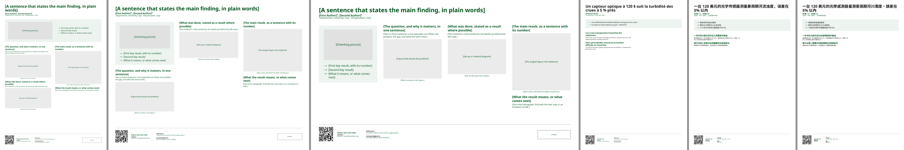

# sci-propos-poster

Assertion-evidence posters for science and engineering, in four languages
(English, French, Simplified and Traditional Chinese):

- a **sentence title** that states the main finding, in plain words;
- an orienting picture with two or three **highlights**, under the title on
  portrait pages and at the top of the first column on landscape pages;
- **sections headed by their message**, a sentence, over large evidence;
  each section stays in one column;
- a **bottom band** with a QR code to the paper and data, contact,
  references, acknowledgments and logos, small, as #betterposter and
  Alley's templates advise.

The rules come from Michael Alley's poster guidance (craftscicom.org), the
MIT Communication Lab's #evenbetterposter and Zen Faulkes's *Better
Posters*, paraphrased; no text or templates of theirs are included.



## Start

```typst
#import "@preview/sci-propos-poster:0.1.0": *

#show: poster.with(
  size: "a0",
  title: [A \$120 optical sensor records storm-driven river turbidity within 5 % of a laboratory instrument],
  authors: [#ph[First Author]#inst(1), #ph[Second Author]#inst(2)],
  affiliation: [#inst(1)#ph[Department, University] · #inst(2)#ph[Organization]],
  graphic: image("site.jpg", width: 100%),
  points: ([Weekly samples miss the storms], [The reading is linear to 1000 NTU], [Six months within 5 %]),
  qr: "https://example.org/paper",
  qr-caption: [Paper, data and code],
  contact: [#ph[Name] · #ph[email\@example.org]],
  references: [[1] Author, title, journal (year).],
)

= Weekly samples miss the storms that carry most of the sediment
Two or three sentences at most.
#figure(image("storms.svg", width: 100%), caption: [What to notice.])

#colbreak()
= The output is linear up to 1000 NTU
...
```

`typst init @preview/sci-propos-poster:0.1.0 my-poster` starts from the
template, whose comments say what each part needs. The repository's
[`examples/river-sensor/poster.typ`](https://github.com/johanvx/sci-propos/blob/v0.1.0/examples/river-sensor/poster.typ)
is a complete poster in three sizes.

## Using it before publication

To use the package before it reaches Typst Universe, or to work on it, see
[the repository](https://github.com/johanvx/sci-propos): its README says how to point Typst at a
checkout.

## Options

| Option | Default | |
|---|---|---|
| `size` | `"a0"` | `"a0"` (841 × 1189 mm, 2 columns), `"a0-landscape"` (3), `"a1"` (2), `"48x36"` (48 × 36 in, 3), `"36x48"` (2), `"16:9"` (48 × 27 in e-poster, 4), or `(width:, height:, columns:)`. |
| `columns` | `auto` | The size's default; any number. |
| `title` | | One sentence, sentence case, no final period. Two lines at most. |
| `authors`, `affiliation` | `none` | Mark affiliations with `inst(1)`. |
| `graphic`, `points` | `none` | The orienting picture, and an array of two or three highlights (or free content). |
| `orient` | `auto` | `"band"` (across the page, portrait default) or `"column"` (top of the first column, landscape default). |
| `qr`, `qr-caption` | `none`, `auto` | The link and the words beside the code (`auto` writes the link). |
| `contact`, `references`, `acknowledgments`, `logos` | `none` | The bottom band, in small type. |
| `keep-sections` | `true` | Keep each section in one column (a section taller than a column may still break). |
| `lang` | `"en"` | `"fr"`, `"zh-Hans"`, `"zh-Hant"`. |
| `style` | `"sans"` | `"serif"` for a serif body. |
| `primary` | `#00561F` (green) | The accent color: section messages, highlight arrows, the tint behind the orienting block (made from it), links, placeholders. Any color, e.g. `rgb("#1F4E9A")` for blue; keep at least 4.5:1 contrast on white. |
| `scale` | `auto` | Type scale; `auto` follows the page area (A0 = 1). |
| `font`, `cjk-font`, `code-font`, `math-font` | `auto` | Override one font role. |

Helpers: `highlights(..items)`, `message(msg, body)` (a figure headed by its
own message, for sections with several figures), and from the core
`annotate` (call-outs on a picture, with poster-weight lines), `two-columns`,
`code-panel`, `qr-code`, `credit`, `ph`, `inst`.

## The type ladder

On A0, scaled by the square root of the page area for other sizes:

| Element | Size | Notes |
|---|---|---|
| Title | 84 pt, bold | Readable from about 5 m |
| Authors / affiliation | 38 / 30 pt | |
| Highlights | 40 pt | |
| Section message | 44 pt, bold, primary | |
| Body | 30 pt | Readable from about 1.5 m |
| Captions | 24 pt | |
| Bottom band | 21 pt | |

Figures need labels of at least caption size at print scale: a slide figure
usually needs scaling by 1.5–2 (`scale(170%, reflow: true, ...)`).

## One page, always

A poster is one page. Content that doesn't fit spills onto a second page,
which carries a red flag: cut text or shrink figures until the PDF has one
page. Check every size you will print.

## Checking the print

Render at about 10 dpi to judge the layout from across the room, and print
the PDF on A4 or Letter: if the body text reads at arm's length on the
small print, it reads at 1.5 m on the poster.

## Tests

[`tests/README.md`](https://github.com/johanvx/sci-propos/blob/v0.1.0/poster/tests/README.md) lists the test files and
their expected page counts.

## License

The code is under the MIT license (`LICENSE`). The starter files in
`template/`, which `typst init` copies into your project, are under MIT-0
(`LICENSE-MIT-0`): you may use, change and share the documents you make
from them without keeping any notice.
