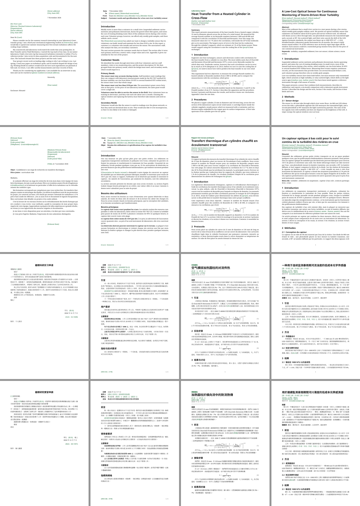

# sci-propos-writing

Letters, memo reports, formal and laboratory reports, and research papers
for science and engineering, in four languages (English, French, Simplified
and Traditional Chinese). The format follows Michael Alley's *The Craft of
Scientific Writing* (4th ed., Springer, 2018), Appendix D:

- serif body text (Noto Serif), bold sans-serif headings and labels (Noto Sans);
- an informative summary or abstract: results with numbers, not a list of contents;
- captions below figures and above tables, an identifying phrase first;
- appendices that each start on a new page, with figures numbered A-1, A-2;
- the conventions of each language for letters, paragraphs and numbering.

Emails are plain text and have no template here.



## Start

```typst
#import "@preview/sci-propos-writing:0.1.0": *

#show: report.with(
  kind: [Laboratory report],
  title: [Heat Transfer from a Heated Cylinder in Cross-Flow],
  authors: ([#ph[Author one]], [#ph[Author two]]),
  affiliation: [#ph[Course] · #ph[University]],
  summary: [What was done, how, what was found (with numbers), and what it means.],
)

= Introduction
...
#show: appendix
= Raw Data
...
#bibliography("refs.bib", style: "chicago-author-date")
```

`typst init @preview/sci-propos-writing:0.1.0 my-report` starts from the
report template. [The gallery](https://github.com/johanvx/sci-propos/tree/v0.1.0/writing/gallery) has a complete sample of
every document type in every language.

## Using it before publication

To use the package before it reaches Typst Universe, or to work on it, see
[the repository](https://github.com/johanvx/sci-propos): its README says how to point Typst at a
checkout.

## Document types

All four take the same common options:

| Option | Default | |
|---|---|---|
| `lang` | `"en"` | `"fr"`, `"zh-Hans"`, `"zh-Hant"`: text language, the words the template writes, and the language's conventions. |
| `style` | `"serif"` | `"sans"` for a sans-serif body. Headings are always sans. |
| `paper` | `"a4"` | `"us-letter"`. Margins 2.5 cm (A4) or 1 in (US Letter). |
| `size` | `auto` (11 pt) | Body size. Noto Serif at 11 pt reads like Times at 12 pt. Headings and captions scale with it. |
| `justify` | `auto` | English ragged right; French and Chinese justified. |
| `primary` | `auto` (green `#00561F`) | The accent color: placeholders `[like this]`, links, package names and the report's kind label. Any color, e.g. `rgb("#B31B1B")`; keep at least 4.5:1 contrast on white. |
| `font`, `heading-font`, `cjk-font`, `code-font`, `math-font` | `auto` | Override one font role. |

### `report`

| Option | |
|---|---|
| `kind` | The document type above the title: `[Laboratory report]`, `[Design report]`. |
| `title`, `subtitle` | A specific title: the field first, then what sets the work apart. Initial capitals in English; sentence case in French. |
| `authors`, `affiliation`, `date` | `authors` is an array or content; `date` a `datetime` (formatted in the language) or content; `auto` is today. |
| `summary`, `summary-title`, `keywords` | The informative summary, its heading (`auto` = Summary, Résumé, 摘要), and keywords. |
| `toc` | `true` adds a table of contents after the summary (long reports). |
| `title-page` | `true` puts the title block alone on the first page. |
| `numbered` | Numbered headings (`1`, `1.1`) and equations; on by default. |

### `memo`

A memo or memo report: a block with Date, To, From, cc and Subject (in the
document's language), a rule, then sections. Alley's model design reports
use this form.

| Option | |
|---|---|
| `to`, `from`, `cc`, `date` | The heading block. |
| `subject` | The document type and its scope, not a one-word label: "Customer needs and specifications for a low-cost river turbidity sensor". |
| `kind` | An optional word above the block: `[Memorandum]`. |
| `note` | Footer text on the left, e.g. the course and term. Pages are numbered "n / N" on the right. |
| `numbered` | Numbered headings; off by default in memos. |

### `letter`

| Option | |
|---|---|
| `sender` | English: your address, set on the right above the date. French: your name, address and contact, top left. Chinese: contact details under the signature. |
| `recipient` | The inside address: on the left (English) or the right (French). Not used in Chinese. |
| `date`, `place` | `place` is French only: "Paris" gives "Paris, le 7 novembre 2026". |
| `subject` | French: the "Objet :" line. Chinese: a centered title. English: a bold line before the salutation. |
| `salutation` | "Dear Dr. Lee:" (US business style, with a colon), "Madame,", "尊敬的王教授：", "王教授鈞鑑：". |
| `closing` | `auto`: "Sincerely,"; the French formule de politesse; 此致／敬礼！ (Simplified) or 敬祝／研安 (Traditional). In Chinese an array of two lines. |
| `signature`, `signature-image` | The typed name; a scanned signature, or blank space for one. |
| `enclosures`, `cc` | "Enclosure:", "P. J. :", "附件：". |

The layouts:

- **English**, modified block style: sender's address and date on the right,
  inside address on the left, indented paragraphs with a blank line between
  them, "Sincerely," and the name aligned with the date, then Enclosure and cc.
- **French**: expéditeur en haut à gauche, destinataire à droite, « Lieu, le
  date », Objet et P. J., civilité, paragraphes justifiés avec alinéa,
  formule de politesse, signature à droite.
- **Chinese**: 称呼顶格，正文首行缩进两字，结尾敬语「此致」缩进、「敬礼！」顶格
  （繁體：「敬祝」「研安」），署名与日期在右下，附件在最后。

### `paper`

A single-column manuscript or preprint (journals apply their own format).

| Option | |
|---|---|
| `title` | |
| `authors`, `affiliations` | `authors: ([Ada#inst(1)], [Alan#inst(1, 2)])`, `affiliations: ([...], [...])`, numbered in order. |
| `correspondence`, `date` | |
| `abstract`, `keywords` | An informative abstract: about 200 words, results with numbers. |

### `appendix`

`#show: appendix` before the first appendix. Each level-1 heading starts a
new page as "Appendix A: Title" (Annexe A : …, 附录 A); figures, tables and
equations inside are numbered A-1, A-2, (A-1). A bibliography after the
appendices keeps its plain heading.

## Figures, tables, equations, references

- `#figure(image(...), caption: [...])`: the caption goes below, labeled
  "Figure 1." in bold sans. A one-line caption is centered; a longer one is
  flush left. Tables get their caption above and the three-line style.
- Refer to every figure and table in the text before it appears: `@fig:nu`
  gives "Figure 1", `@tab:raw` "Table A-1", `@eq:cb` "Equation 1".
- Equations are numbered on the right in reports and papers.
- References: `#bibliography("refs.bib", style: ...)`. Author-year in
  brackets is Alley's default format (`"chicago-author-date"` is the closest
  built-in style); numbered `"ieee"` is common in engineering; Chinese
  documents often use `"gb-7714-2015-numeric"`.

## Fonts

Noto Serif and Noto Sans (Noto Serif SC/TC and Noto Sans SC/TC for Chinese),
Noto Sans Mono for code, New Computer Modern Math. Typst bundles only the
math font; install the others. `--input fonts="$(typst fonts | paste -sd, -)"`
makes the package pick the first installed candidate without warnings (see
the [`sci-propos-presentation`](https://typst.app/universe/package/sci-propos-presentation) README for
the details, which are the same).

## Gallery and tests

[`gallery/`](https://github.com/johanvx/sci-propos/tree/v0.1.0/writing/gallery) in the repository holds the samples,
built with `typst compile --root . gallery/<file>.typ`: `letter.typ` (`--input lang=en|fr|zh-Hans|zh-Hant`,
`--input paper=us-letter`), and `memo-*.typ`, `lab-*.typ`, `paper-*.typ` in
each language. All names and data in them are placeholders or illustrative.
[`tests/README.md`](https://github.com/johanvx/sci-propos/blob/v0.1.0/writing/tests/README.md) lists the test files and
their expected page counts; [`previews/`](https://github.com/johanvx/sci-propos/tree/v0.1.0/writing/previews) has the
gallery rendered as PDFs.

## License

The code is under the MIT license (`LICENSE`). The starter files in
`template/`, which `typst init` copies into your project, are under MIT-0
(`LICENSE-MIT-0`): you may use, change and share the documents you make
from them without keeping any notice.
The format rules are paraphrased from Michael Alley's books and
websites, which remain his; no text or templates of his are included.
